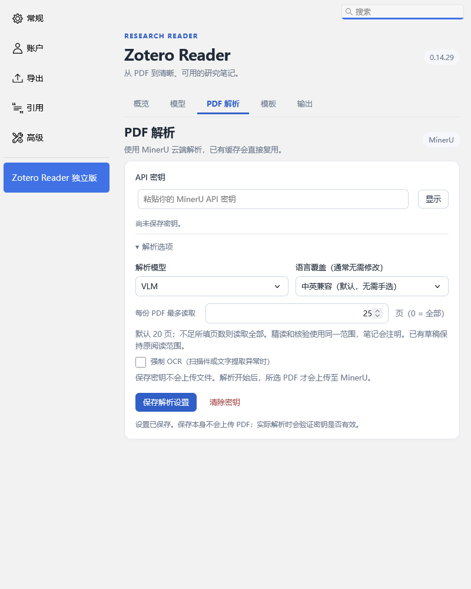

# Zotero Reader

在 Zotero 中完成 **PDF 解析 → 文献精读 → 独立检查与修订 → 保存笔记 → 按需归档**。

当前版本：**1.0.1**。支持在任意分类中单篇或批量精读，也可以监听一个待处理分类。普通轮换电脑使用不需要开启多机协作。

**[获取最新版（Latest）](https://github.com/sword-raining/zotero-reader-independent/releases/latest)** · [直接下载 1.0.1 安装包](https://github.com/sword-raining/zotero-reader-independent/releases/download/v1.0.1/zotero-reader-independent-1.0.1.xpi) · [版本说明](docs/RELEASE-1.0.1.md) · [历史版本](https://github.com/sword-raining/zotero-reader-independent/releases) · [反馈问题](https://github.com/sword-raining/zotero-reader-independent/issues)

> 这是第三方插件。扩展声明兼容 Zotero 7–10，目前主要在 Windows / Zotero 10.0.8 上验证。多设备同时运行的任务标记仍需在你自己的 WebDAV 服务上检测通过；它不是日常使用的前提。

## 1. 安装前准备

| 需要什么 | 用途 |
| --- | --- |
| Zotero 与可以打开的 PDF 附件 | 管理文献、接收笔记 |
| [MinerU API](https://mineru.net/apiManage/docs) 的密钥 | 把 PDF 转为供模型使用的文字与结构化内容 |
| 已安装并登录的 Codex CLI 或 Antigravity CLI | 调用模型精读和检查；可使用其中一个，也可分别使用两个 |
| 可用网络与相应服务额度 | 云解析及模型请求会使用各自的额度 |

CLI 的安装和登录按官方说明完成：[Codex CLI](https://developers.openai.com/codex/cli/) · [Antigravity CLI](https://antigravity.google/docs/getting-started?tab=cli)。只登录网页或桌面聊天窗口，不等于 CLI 已登录。

普通使用者**不需要克隆仓库，也不需要运行 Python 检查脚本**。Node.js、Python 是开发和构建时使用的工具；CLI 自身的安装依赖按它的官方说明准备。

## 2. 安装插件

1. 下载上面的 **`.xpi` 安装包**。GitHub 自动生成的 `Source code.zip` 是源码，不是插件安装包。
2. 在 Zotero 打开 **工具 → 插件**，把 `.xpi` 拖进插件窗口；也可以使用从文件安装的入口。
3. 等当前任务结束后重启 **Zotero**，不需要重启电脑。
4. 打开 **设置 → Zotero Reader 独立版**。也可右键文献，选择 **Zotero Reader → 设置…**。

当前采用手动下载 XPI 升级，暂不提供自动更新通道。升级请使用完整安装包，不要只替换几个新文件。

## 3. 第一次配置

**PDF 解析**：填入 MinerU API 密钥，点击“保存解析设置”。展开“解析选项”，在“每份 PDF 最多读取”中直接输入数字：默认 `20`，`25` 表示前 25 页，`0` 表示不主动限制页数。当前输入范围为 0–200 的整数；云服务自身的文件和页数限制仍然适用。

不足所填页数时读取全部。精读和核验使用同一范围，笔记会注明；改设置不会悄悄改变已经生成的旧草稿范围。

**模型**：分别给“精读”和“后台检查”选择调用通道、型号及思考强度。先刷新模型目录，再选择实际检测到的型号，分别点击“测试连接”。可以用不同模型做精读和检查。可用型号由你的账号和 CLI 决定，不是仓库中列出的固定清单。

如果提示找不到程序，在“高级与检测信息”中填写本机 CLI 可执行文件路径，或留空重新检测。不要复制另一台电脑的固定路径和登录凭据。这里的“每步超时 / 分钟”也用于单独补归档、更新推荐。

**输出**：选择“自动导入 Zotero 笔记”，或“先生成 Markdown，查看后手动导入”。第一次建议先用 1–2 篇有 PDF 的文献试用，确认结果符合预期后再扩大批次。

<details>
<summary>查看页数输入示例</summary>



</details>

## 4. 读第一篇，或批量读已有文献

在**任何分类**中选中文献或 PDF，右键选择 **Zotero Reader → 精读文献… / 精读选中文献…**。

在选择窗口核对正文 PDF 和模板，再加入队列。插件会尝试识别正文、补充材料和不同版本，优先已发表版本；可以手动改选。补充材料默认不读，只有勾选后才纳入。

批量窗口默认跳过已有精读结果和中文论文；可以按本批需要取消跳过。已有普通手写笔记不会一概视为插件已经精读。概览中的“默认跳过中文论文”也控制单篇、自动监听和续检。

任务队列右上使用同一个按钮：**开始 / 全部暂停**。暂停会保留草稿和等待任务；已经提交给云服务的请求不保证能撤销全部消耗。

## 5. 让新文献自动进入流程（可选）

在概览中选择“监听分类”，例如自己创建的 `00_新导入文献`，再勾选“启用”。

此后直接加入这个分类的文献及其新 PDF 会进入自动流程。默认不补扫已有条目、不包含子分类。**已有旧论文直接用右键批量精读即可，不必为了启动任务先搬进导入箱。**

`00_新导入文献` 不是必须使用的名称。它只是一个待处理入口：笔记保存且归档完成后，可以移出；尚未完成的任务继续保留，便于识别。

## 6. 查看、继续检查和保存笔记

| 任务情况 | 怎么操作 |
| --- | --- |
| 正在处理 | 等待，或使用暂停；不要重复提交同一篇 |
| 检查未完成 / 已停止且有完整草稿 | 点击“继续检查”，使用保留的原稿继续 |
| 草稿待复核 | 查看具体问题，使用“自动修订并复查”或编辑草稿 |
| 等待保存笔记 | 点击“查看结果”后保存；也可使用队列中的“一键保存待保存笔记” |
| 已保存 | 点击“查看笔记”，在 Zotero 中阅读 |

独立检查发现问题后会按设置修订并重新检查。完整草稿通常无需重新解析或生成；初稿还没生成完的步骤可能需要重做。人工修改稿可以单独导入，并明确标为未重新核验，不会伪装成已检查。

保存成功后，插件会清理可安全删除的生成缓存。因此需要长期保留成果时，以 **Zotero 中已保存的笔记**为准；尚未保存或后来修改过的 Markdown 会保留，不静默覆盖。

默认模板包含置顶“核心发现”、文献信息及研究背景、动机、发表价值、设计、方法、主要结果、机制、局限和启发。顶部摘要独立归纳并核验，不只是截取第一条结果。影响因子与分区读取 Zotero One 已写入的信息，不另行搜索。

## 7. 保存后归档

归档在笔记保存后进行。概览中的“精读完成后的归档”有以下选择：

| 选项 | 行为 |
| --- | --- |
| 自动归档（已有分类调整需确认） | 默认模式；未归类新文献可以按建议归档，已有归属需要调整时先确认 |
| 自动按建议处理（新增与移出） | 自动采用明确的新增、移出建议，保留未被建议调整的其他分类 |
| 逐篇确认后归档 | 查看理由，勾选分类后执行；可自行添加更多分类 |
| 不自动归档 | 保留当前分类，精读和保存仍可继续 |

如果不希望自动改分类，开始前选择“逐篇确认后归档”或“不自动归档”。已保存任务可重新打开“归档／添加分类”；重新生成建议不需要重读论文。

**清理已完成任务**只清理符合条件的生成缓存和队列历史，保留 PDF、已保存笔记和分类。未导入、未完成归档或后续修改的任务会保留并说明原因。

## 8. 换电脑与跨设备任务标记

**普通轮换使用无需开启任务标记。**每台安装插件并完成本机 CLI 登录；PDF 使用 Zotero 文件同步，已保存笔记使用 Zotero 数据同步。同步完成后，另一台可识别已有结果并跳过重复处理。未导入草稿、核验进度和解析缓存仍留在原机，不自动接力迁移。

只有多台可能同时处理重叠文献时，才使用 **概览 → 跨设备任务标记（可选）**：

- 实际领取任务时记录“处理中”，另一台发现已被领取就读别篇。
- 保存成功后记录完成；状态显示在任务队列里。
- 没有入队或没有领取的文献不批量标记，也不会因此改变原分类。
- 所有参与端需使用新版并在同一 WebDAV 存储上检测开启。检测失败先看具体原因，不强制绕过；普通轮换使用不依赖它。

这项仍是试用功能。0.14.29 修正了部分服务用 HTTP 409 表示已有目标版本时的判断，但必须再核对目标确实存在；不是把所有 409 都忽略。详细行为见[多设备说明](docs/COORDINATION.md)。

## 常见问题

**为什么停在导入箱？**

检查和保存还没完成时，不会自动归档出箱。先查看该篇任务的具体状态，不要通过删除文献、清空索引来重试。

**提示核验编号缺失、重复或输入不完整？**

保留草稿。插件会保留核验输出定位与编号差异；长 Antigravity 输入会分段确认送达后执行最终任务。仍失败时反馈新错误，不要把空核验结果当作通过。

**提示本地索引异常？**

原文件与可用备份会保留，相关写入被阻止。不要删除 `queue.json` 或保存回执；核对诊断并修复后再重新加载。

**多机检测出现 HTTP 409 或其他错误？**

提供插件数据目录内的 `coordination-diagnostic.json`，它记录检测步骤和状态码。失败不代表论文出错，也不证明另一台正在读。无需并行处理时可关闭任务标记。

**为什么重读没有替换旧笔记？**

插件不会静默覆盖人工编辑。不同次主动重读的主笔记替换和版本管理尚未完善，应自行核对后处理已有结果。

## 数据去向与限制

- 云解析会上传选定的 **整个 PDF 文件**到 MinerU；页数设置限制解析范围，并不等于先裁出这些页再上传。
- 解析后的阅读范围文字会发送至你选择的模型通道。单独更新归档推荐会发送已保存笔记文本和可选分类信息。
- 当前检查基于解析文字，不能宣称完整核验了所有原始图像，也不能保证消除所有模型错误。
- 凭据由用户在本机输入或登录，不包含在安装包里。草稿与缓存不用于跨设备同步。
- Wiki / Obsidian 自动入库尚未作为稳定功能交付，本插件不修改第三方 `dsh-kb`。

反馈问题时请提供插件版本、系统、通道、复现步骤和错误信息。不要公开提交 API 密钥、登录文件、真实 Zotero 数据库或论文全文。需要详细诊断时，先去除敏感内容。

## 开发与构建

源码在 `project/`，安装包在 `release/`，验证记录在 `validation/`。维护指南：[START_HERE.md](START_HERE.md)、[HANDOFF.md](docs/HANDOFF.md)、[Windows 开发说明](docs/WINDOWS.md)。

```powershell
git clone https://github.com/sword-raining/zotero-reader-independent.git
cd zotero-reader-independent
python tools/check.py --baseline
```

开发检查需要 Node.js 和 Python，不需要 `npm install`。修改后运行 `python tools/check.py`，可重建 XPI 输出至 `.work/`。基础检查不启动 Zotero、不调用模型；真实调用和原生测试必须另行明确执行。当前验证范围见[版本说明](docs/RELEASE-1.0.1.md)。

## 开源许可

Copyright (c) 2026 sword-raining.

本项目由 sword-raining 提供的源码、配套文档及发布安装包采用 **GNU General Public License v3.0 only（SPDX: `GPL-3.0-only`）**，完整条款见 [LICENSE](LICENSE)。

- 允许使用、修改、分发及商用。
- 分发本程序或其衍生版本时，应保留版权和许可声明、标明修改，并按 GPL-3.0 提供对应源码及构建所需文件；衍生版本须继续遵守该许可。
- 本程序不提供适销性、特定用途适用性等担保，具体以许可证为准。

本授权不改变 Zotero、MinerU、Codex CLI、Antigravity CLI 等独立软件或服务的许可与使用条款，也不授予第三方论文、PDF 或用户笔记的版权。使用插件生成的普通笔记不会仅因使用本插件而必须按 GPL 发布。

1.0.0 已发布 XPI 的字节与校验值保持不变；同一 [Release 页面](https://github.com/sword-raining/zotero-reader-independent/releases/tag/v1.0.0) 提供许可证及附带许可声明的对应源码下载。再分发时请一并提供许可声明和完整许可证。
